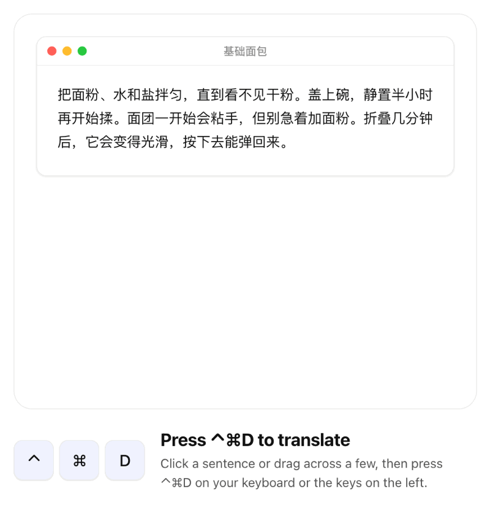

# Lumo — downloads and updates

Translate what you just selected, anywhere on macOS. Select text, press the hotkey, read the translation where you were already looking; with nothing selected, type into the same panel. Lives in the menu bar. Requires macOS 26.

**[Download the latest version](https://github.com/max1874/lumo-releases/releases/latest)** — a signed, Apple-notarized .dmg

<a href="https://max1874.com/lumo/"></a>

<sub>A recorded demo from [max1874.com/lumo](https://max1874.com/lumo/), where you can try it yourself.</sub>

[中文](README.zh-CN.md)

After installing you never need to come back here: Lumo checks for updates once a day, and the menu bar has a "检查更新…" item.

## What is in this repository

- `appcast.xml` — the update feed Lumo reads to find out whether a newer version exists.
- Releases — the disk image for each version, with its SHA-256.

The source code is not here.

## Verifying a download

```sh
shasum -a 256 -c Lumo-1.0.2.dmg.sha256
```

The image and the app inside it are notarized and stapled separately, so it opens without asking Apple — offline included — and without the "cannot verify the developer" dialog.
